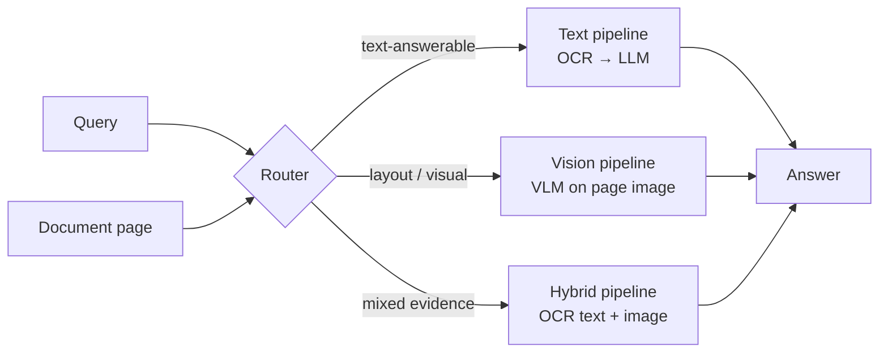

# Query-Based Document Understanding

A document understanding system that decides, **per query**, whether to answer from the
document's **text** (OCR + language model), its **image** (vision-language model), or a
**hybrid** of both.

> Final-year capstone project — Computer Engineering, İstanbul Gedik University (2026–2027).
> Advisor: Dr. Öğr. Üyesi Hikmet Canlı.

## Motivation

OCR-based pipelines are cheap and strong on text-heavy pages, but they lose information on
tables, forms, charts and layout-dependent questions. Vision-language models handle those
cases but cost far more per query. Most systems commit to one modality up front. This project
chooses the modality **from the query itself**, aiming for accuracy close to the best single
pipeline at a fraction of the cost.

## Architecture



| Component | Status |
|---|---|
| Text, vision and hybrid pipelines | done (model-provider independent) |
| OCR (Tesseract, cached) | done |
| Benchmark: DocVQA sample, ANLS, cost, routing oracle | done |
| Model providers | not chosen yet (a fake model is used for tests) |
| Router | next: trained on the routing oracle's labels |

## Repository layout

```
src/qdu/
  cli.py            Command-line entry point (`qdu`)
  pipelines/        Text, vision and hybrid answering pipelines
  models/           Provider-independent LLM/VLM interface (+ a fake model for tests)
  ocr/              OCR engines (Tesseract, cached per page)
  data/             DocVQA loading, question records, manifests, stratified sampling
  evaluation/       ANLS and routing-oracle analysis
  benchmark.py      Sample -> run -> report
  runner.py         Resumable pipeline runs -> scored predictions (JSONL)
  provenance.py     Run metadata (git commit, versions) written next to every result
tests/              pytest suite
benchmarks/         Committed benchmark samples (question manifests)
runs/               Benchmark run outputs (gitignored)
data/               Local caches (gitignored)
```

## Setup

Requirements: [uv](https://docs.astral.sh/uv/) and [Tesseract OCR](https://github.com/tesseract-ocr/tesseract).

```powershell
# Windows
winget install astral-sh.uv
winget install UB-Mannheim.TesseractOCR

git clone https://github.com/emre-geris/query-based-document-understanding C:\Users\<you>\source\query-based-document-understanding
cd C:\Users\<you>\source\query-based-document-understanding
uv sync                       # creates .venv and installs locked dependencies (Python 3.13)
uv run pre-commit install     # run ruff and hygiene checks on every commit
```

> Keep the clone **outside OneDrive**. Syncing a `.venv` (hundreds of MB) or a `.git`
> folder through OneDrive is slow and can corrupt both.

## Usage

```powershell
# Answer a question about a page image
uv run qdu answer --image page.png --question "What is the total?" --pipeline hybrid --vision-model <spec>

# Benchmark on DocVQA validation
uv run qdu benchmark sample                                        # once: fixed 200-question sample
uv run qdu benchmark run --text-model <spec> --vision-model <spec> # resumable
uv run qdu benchmark report runs/<run-name>                        # ANLS per pipeline/type, oracle
```

`uv run qdu --help` lists all options. Until a provider is added, `fake` is the only model
spec; its answers are meaningless and only exercise the wiring.

### Benchmark design

| | |
|---|---|
| Data | DocVQA validation (`lmms-lab/DocVQA`), downloaded to the Hugging Face cache on first use |
| Sample | 200 questions, at most one per document, stratified by question type (rarest label), at least 10 per type, seed 42 |
| Metric | ANLS per question; mean per pipeline and per type |
| Cost | input/output tokens and model latency per call; OCR time per page |
| Routing oracle | best pipeline per question; ties go to the cheaper one (text < vision < hybrid). Its mean ANLS is the ceiling for any router, its choices are the router's training labels |

## Development

```powershell
uv run pytest            # tests
uv run ruff check .      # lint
uv run ruff format .     # format
uv add <package>         # add a runtime dependency (updates pyproject.toml and uv.lock)
```

Commits follow [Conventional Commits](https://www.conventionalcommits.org/)
(`feat:`, `fix:`, `docs:`, `test:`, `refactor:`, `chore:`, `ci:`).
