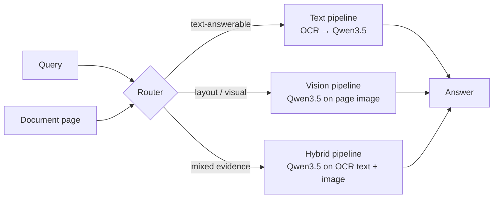

# Query-Based Document Understanding

A document understanding system that decides, **per query**, whether to answer from the
document's **text** (OCR + language model), its **image** (vision-language model), or a
**hybrid** of both.

> Final-year capstone project — Computer Engineering, İstanbul Gedik University (2026–2027).
> Advisor: Dr. Öğr. Üyesi Hikmet Canlı.

## Motivation

OCR-based pipelines are cheap and strong on text-heavy pages, but they lose information on
tables, forms, charts and layout-dependent questions. Vision-language models handle those
cases but cost far more per query. Most systems commit to one modality up front. This project
chooses the modality **from the query itself**, aiming for accuracy close to the best single
pipeline at a fraction of the cost.

## Architecture



| Component | Status |
|---|---|
| Text, vision and hybrid pipelines | done (model-provider independent) |
| OCR (Tesseract, cached; PP-OCRv5 optional) | done |
| Benchmark: DocVQA, InfographicVQA, ChartQA, TAT-DQA; per-dataset metric, cost, routing oracle | done; pilot in `results/pilot-qwen3.5-4b` |
| Model | Qwen3.5-4B via vLLM, `openai:<model>` provider (`fake` for tests) |
| Router | next: trained on the routing oracle's labels |

## Repository layout

```
src/qdu/
  cli.py            Command-line entry point (`qdu`)
  pipelines/        Text, vision and hybrid answering pipelines
  models/           Provider-independent LLM/VLM interface (+ a fake model for tests)
  ocr/              OCR engines (Tesseract, PP-OCRv5; cached per page)
  data/             Dataset registry (DocVQA, InfographicVQA, ChartQA, TAT-DQA), document-level splits, manifests, sampling
  evaluation/       ANLS, relaxed accuracy, EM/F1, per-dataset primary metric, routing oracle
  benchmark.py      Sample -> run -> report
  runner.py         Resumable pipeline runs -> scored predictions (JSONL)
  provenance.py     Run metadata (git commit, versions) written next to every result
tests/              pytest suite
benchmarks/         Committed benchmark samples (question manifests)
results/            Committed results of finished GPU runs, each with a README
notebooks/          GPU runbook (Colab)
runs/               Benchmark run outputs (gitignored)
data/               Local caches (gitignored)
```

## Setup

Requirements: [uv](https://docs.astral.sh/uv/) and [Tesseract OCR](https://github.com/tesseract-ocr/tesseract).

```powershell
# Windows
winget install astral-sh.uv
winget install UB-Mannheim.TesseractOCR

git clone https://github.com/emre-geris/query-based-document-understanding C:\Users\<you>\source\query-based-document-understanding
cd C:\Users\<you>\source\query-based-document-understanding
uv sync                       # creates .venv and installs locked dependencies (Python 3.13)
uv run pre-commit install     # run ruff and hygiene checks on every commit
```

> Keep the clone **outside OneDrive**. Syncing a `.venv` (hundreds of MB) or a `.git`
> folder through OneDrive is slow and can corrupt both.

## Usage

```powershell
# Answer a question about a page image
uv run qdu answer --image page.png --question "What is the total?" --pipeline hybrid --vision-model <spec>

# Datasets and benchmark
uv run qdu data download                                           # once: all datasets -> HF cache
uv run qdu benchmark sample                                        # pilot: 100 questions per dataset
uv run qdu benchmark sample --all-questions --split all --out benchmarks/<name>.csv  # full labelling
uv run qdu benchmark run --text-model <spec> --vision-model <spec> --manifest <csv> --name <run>  # resumable
uv run qdu benchmark report runs/<run-name> [--cost tokens]       # metrics, cost, oracle
uv run qdu benchmark rescore runs/<run-name>                       # re-derive answers after a clean_answer change
```

### Running on a GPU (Colab)

Open `notebooks/gpu_pilot.ipynb` in Google Colab (runtime **L4** or **A100**; Qwen3.5 failed to start on a T4 in our attempt) and run the cells top to bottom. It serves Qwen3.5-4B with vLLM on the same machine (caches off, launch flags recorded with the run), runs `MANIFEST` with `--text-model openai:Qwen/Qwen3.5-4B --vision-model openai:Qwen/Qwen3.5-4B`, and zips the run for download. The `openai:<model>` provider reads `QDU_OPENAI_BASE_URL` (default `http://localhost:8000/v1`).

`uv run qdu --help` lists all options. The `fake` model spec only exercises the wiring; its
answers are meaningless and must never be reported.

### Benchmark design

| | |
|---|---|
| Data | DocVQA and InfographicVQA validation, ChartQA test (labelled evaluation splits; see CLAUDE.md) |
| Pilot sample | 100 questions per dataset from the router-train split, at most one per document, stratified by question type, seed 42 |
| Full labelling | every question × 3 paths; confidence intervals resample documents |
| Metric | each dataset's conventional metric: ANLS (DocVQA, InfographicVQA), relaxed accuracy (ChartQA), F1 (TAT-DQA); all four reported for every dataset |
| Cost | two measures: latency (model + OCR seconds) and tokens (input + output) |
| Routing oracle | best pipeline per question by the primary metric; ties go to the pipeline with the lower measured cost. Its mean is the ceiling for any router, its choices are the router's training labels |

## Development

```powershell
uv run pytest            # tests
uv run ruff check .      # lint
uv run ruff format .     # format
uv add <package>         # add a runtime dependency (updates pyproject.toml and uv.lock)
```

Commits follow [Conventional Commits](https://www.conventionalcommits.org/)
(`feat:`, `fix:`, `docs:`, `test:`, `refactor:`, `chore:`, `ci:`).
